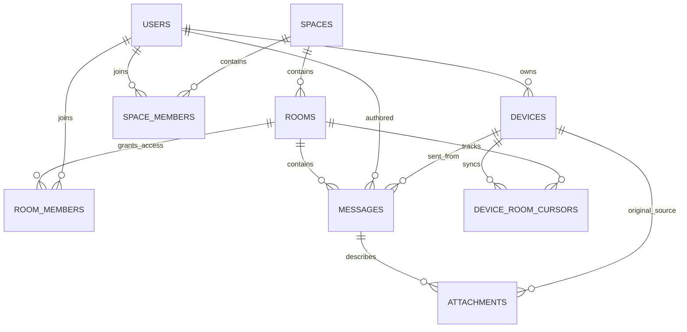

# Database — schema v1

The SQLite schema lives at [server/sync_devices/schema.sql](../server/sync_devices/schema.sql). It stores **zero attachment bytes**.

## Entity relationships

### Core tables

- **users** — person/account. Multiple devices may represent the same user.
- **devices** — separately authorized installation with identity public key and revocation date. A user may use the phone and PC at different times.
- **spaces** — Discord-like server/community (initially one home space).
- **space_members** — who is allowed into a space, with owner/member roles.
- **rooms** — channels or direct conversations; direct conversations have no name.
- **room_members** — explicit per-room access list (also for channels in v1).
- **messages** — server-assigned, monotonically increasing integer `seq` for pagination; globally unique `id`; unique pair `(author_device_id, client_message_id)` for retry idempotency.
- **attachments** — filename, MIME type, nonnegative byte size, optional SHA-256 and **source_device_id**. No data blob, no server URL to file.
- **device_room_cursors** — last acknowledged server `seq` per device and room.

### Offline scenario

1. Android posts a message to `#general`, and the server commits it with sequence `N`.
2. Android disconnects. The text remains in SQLite.
3. An hour later, the user's Windows client authenticates and asks for messages where `seq > last_seen_seq` in authorized rooms.
4. Windows receives the missed text, updates its cursor only after processing it, and can render attachment *metadata*.
5. If a source device is disconnected, the file is shown as **currently unavailable**; no binary bytes are on the server.

A device fetches only rooms for which its **authenticated owner** is a current room member. Room membership and device ownership must be checked in application code, not taken from request parameters.

### Deletions, ordering, uniqueness

- Server arrival ordering uses `messages.seq`, not client clock timestamps. `created_at` is informational.
- Retried sends reuse the same device-specific `client_message_id`; the server should return the original committed message rather than duplicate it.
- `deleted_at` is a tombstone. Normal clients do not hard-delete message rows because historical cursors must keep working.
- File availability is ephemeral; the database does **not** assert online status.
- Membership in `space_members` does not automatically authorize room reads; require `room_members` too.
- Schema v1 is for fresh instances. Future schema changes require explicit versioned migrations.

### Server storage budget

Text and metadata are small compared with media, but disk is **not** unlimited. Apply quotas for message length, message rate, username length, attachment metadata sizes and database retention/backups. Do not conflate a reported `size_bytes` with server allocation.
